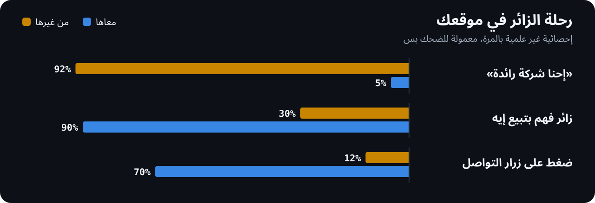

<p align="center"><a href="README.md">English</a> · <b>العربية</b></p>

<p align="center"></p>

> **صفحات موقع بتجيب عملاء، مش بس زوار.** تبحث وتكتب وتراجع صفحات المواقع التجارية: الرئيسية ومن نحن وتواصل معنا والخدمات والمنتجات، عشان SEO وبحث الذكاء الاصطناعي والتحويل.

## بتشتغل إزاي؟

<p align="center"></p>

## قولها كده وسيبها تشتغل

- «اكتب محتوى الصفحة الرئيسية لموقعي»
- «راجع صفحة الخدمة دي»

## النتايج (بهزر، بس بجد مفيدة)

<p align="center"></p>

## ركّبها في دقيقة

| بتستخدم إيه؟ | الطريقة |
|---|---|
| حساب Claude أو ChatGPT | نزّل [`website-content-seo-ai.zip`](https://github.com/Marsadgrouplabs/website-content-seo-ai/releases/latest/download/website-content-seo-ai.zip) وارفعه من قسم Skills |
| Claude Code | `claude plugin marketplace add Marsadgrouplabs/website-content-seo-ai` |
| Claude Code أو Codex بسكربت | حمّل الـ repo وشغّل `install.ps1` أو `install.sh` |

<details>
<summary><b>الخطوات بالتفصيل</b></summary>

### حساب Claude أو ChatGPT

1. نزّل [`website-content-seo-ai.zip`](https://github.com/Marsadgrouplabs/website-content-seo-ai/releases/latest/download/website-content-seo-ai.zip) وماتفكّهوش.
2. **Claude:** افتح قسم Skills في حسابك واختار رفع ملف.
3. **ChatGPT:** افتح Skills، ثم Create، ثم Upload from your computer. الميزة متاحة حسب خطة الحساب.

### Claude Code كـ Plugin

```bash
claude plugin marketplace add Marsadgrouplabs/website-content-seo-ai
claude plugin install website-content-seo-ai@marsad-website-content-seo-ai
```

### ويندوز

```powershell
git clone https://github.com/Marsadgrouplabs/website-content-seo-ai.git
cd website-content-seo-ai
powershell -ExecutionPolicy Bypass -File .\install.ps1
```

### ماك أو لينكس

```bash
git clone https://github.com/Marsadgrouplabs/website-content-seo-ai.git
cd website-content-seo-ai
bash install.sh
```

السكربت بيركّبها لـ Claude Code في `~/.claude/skills` ولـ Codex في `~/.agents/skills`، ولو فيه نسخة قديمة بيحتفظ بيها.

</details>

## مطمنك: مين الناشر وبياناتك فين؟

الناشر هو **[Marsad Labs](https://labs.marsadgroup.co)**. Marsad Labs هي ذراع المنتجات في Marsad Group، شركة تسويق مسجلة في بريطانيا، وبتبني أدوات عملية للمسوقين والمطورين. [اعرف أكتر عننا](https://labs.marsadgroup.co/about-us/) · [سياسة الخصوصية](https://labs.marsadgroup.co/privacy-policy/)

| السؤال | الإجابة |
|---|---|
| **بتقرا إيه؟** | بيانات نشاطك وصفحاتك اللي بتديهالها. |
| **بتتصل بإيه؟** | أدوات البحث المتاحة في حسابك، لو سمحت لها بالبحث. |
| **محتاجة مفاتيح؟** | لأ. |
| **الكود** | تعليمات ومراجع نصية بس، ومفيهاش أي سكربتات بتشتغل على جهازك. |

النسخة دي اتفحصت بأداة SkillSpector، واتراجعت تنبيهاتها الحرجة والعالية يدوياً، واتشال منها أي بيانات عملاء أو مفاتيح. النتيجة الكاملة وطريقة التأكد من الملف والإبلاغ عن مشكلة في [`SECURITY.ar.md`](SECURITY.ar.md).

## محتاج إيه؟

- مفيش متطلبات خاصة.

## الحقوق

كل الحقوق محفوظة لـ Marsad Labs. ممنوع النسخ أو إعادة النشر بدون إذن.

---

<p align="center">معمولة بحب وشاي كتير في <a href="https://labs.marsadgroup.co"><b>Marsad Labs</b></a></p>
